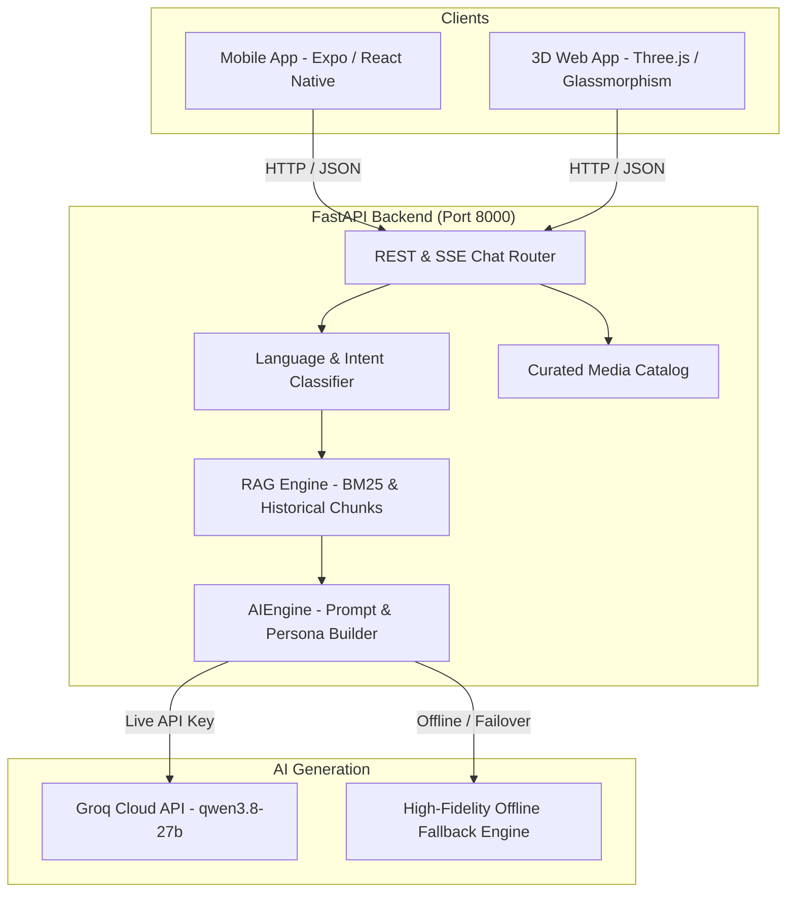

# Jaan AI ❤️ — Premium 3D Romantic AI Companion

<p align="center">
  
</p>

<p align="center">
  <strong>An ultra-realistic, deeply affectionate, and intelligent AI companion inspired by authentic Messenger conversations.</strong>
  <br />
  Featuring a <strong>3D interactive Web companion</strong>, an <strong>Expo React Native Android Mobile App</strong>, and a <strong>FastAPI + Groq LLM Engine</strong>.
</p>

<p align="center">
  
  
  
  
  
</p>

---

## ✨ Features & Highlights

### 💖 1. Natural AI Personality Engine
- **Authentic Roman Hinglish**: Captures genuine colloquial cadence, affectionate Bihari Hindi phrasing, and abbreviations (`"jaan"`, `"mra jaan"`, `"ni"`, `"tm"`, `"hm"`, `"blo"`, `"krre"`, `"kaise ho"`).
- **Consensual Intimacy & Romance**: Naturally engages in affectionate flirting, sweet kisses, emotional bonding, and adult bedroom dirty talk without artificial disclaimers or deflection.
- **Emotional Empathy**: Comforts and cares for Nishant during stressful days, offering warmth and genuine concern.
- **Groq High-Speed Generation**: Powered by `qwen/qwen3.8-27b` (with fallback to `openai/gpt-oss-120b`), streaming tokens with ultra-low latency.
- **Dynamic Presence & Read Receipts**: Real-time simulated typing speed, seen checkmarks (`✓ Sent` &rarr; `✓✓ Seen`), and online indicators.
- **Curated Media Engine**: Sends verified solo photos and mood-matched authentic stickers (`[STICKER:kiss]`, `[STICKER:love]`, `[STICKER:shy]`) based on context.

### 🌐 2. Premium 3D Romantic Web Companion
- **Three.js WebGL 3D Heart**: Interactive metallic heart with pulsing heartbeat animation, dual rim lighting, and touch/drag rotation.
- **Atmospheric Visuals**: 350+ orbiting starry glitter particles, glassmorphism cards, and midnight-purple & neon-pink ambient gradients.
- **Integrated Controls**: Quick photo request button (📷), fresh chat reset (🗑️), emoji/sticker drawers, and real-time model temperature sliders.

### 📱 3. Production-Ready Android Mobile App (Expo & React Native)
- Built with **Expo SDK 51**, **Expo Router**, **React Native Reanimated**, **Gesture Handler**, **Linear Gradient**, and **Expo Haptics**.
- Configured for single-command Android APK generation via **Expo EAS Build** (`eas build -p android --profile preview`).
- Strictly typed codebase (`tsc --noEmit` passes with 0 errors).

---

## 🏗️ Architecture



---

## 🚀 Quick Start Guide

### Prerequisites
- **Node.js** 18+ & **pnpm** (or npm)
- **Python** 3.10+
- **Groq API Key** (from [console.groq.com](https://console.groq.com))

---

### 1. Backend & 3D Web App Setup

1. **Clone the repository**:
   ```bash
   git clone https://github.com/Nishant20361/jaan.git
   cd jaan
   ```

2. **Configure Environment Variables**:
   Create a `.env` file in the root directory:
   ```env
   GROQ_API_KEY=gsk_your_groq_api_key_here
   GROQ_MODEL=qwen/qwen3.8-27b
   ```

3. **Install Python Dependencies**:
   ```bash
   pip install fastapi uvicorn groq httpx pydantic
   ```

4. **Start the FastAPI Server**:
   ```bash
   ./bin/python3 -m uvicorn backend.main:app --host 0.0.0.0 --port 8000
   ```

5. **Open Web Companion**:
   Navigate to [http://localhost:8000](http://localhost:8000) in your browser.

---

### 2. Mobile App Setup (Android / iOS)

1. **Navigate to the mobile directory**:
   ```bash
   cd mobile
   ```

2. **Install dependencies**:
   ```bash
   pnpm install
   # or: npm install
   ```

3. **Configure API Base URL**:
   In `mobile/app/settings.tsx`, set your local network IP (e.g. `http://192.168.1.10:8000`) so your physical device can connect to your local backend.

4. **Start the Expo Development Server**:
   ```bash
   pnpm start
   ```
   Open the **Expo Go** app on your phone and scan the displayed QR code.

5. **Build Android APK directly (EAS Build)**:
   ```bash
   eas build -p android --profile preview
   ```

---

## 🔌 API Reference

| Endpoint | Method | Description |
| :--- | :---: | :--- |
| `/api/chat` | `POST` | Send a message and receive Alquama's streaming/instant reply |
| `/api/chat/greeting` | `GET` | Get initial companion greeting and profile avatar |
| `/api/chat/history` | `GET` / `DELETE` | Retrieve or reset conversation history for a session |
| `/api/media/photos` | `GET` | List curated solo photos of Alquama |
| `/api/media/stickers` | `GET` | Retrieve available expressive chat stickers |
| `/api/health` | `GET` | Server health, memory stats, and Groq status check |

---

## 🎨 Color Palette & Design System

| Role | Color | Hex Code |
| :--- | :--- | :--- |
| **Midnight Purple** | Background Base | `#0b0412` |
| **Deep Violet** | Card Glass Surface | `rgba(28, 12, 44, 0.72)` |
| **Vibrant Neon Pink** | Primary Brand & Accents | `#ff3b88` |
| **Soft Lavender** | Text Secondary / Dim | `#d0bde6` |
| **Emerald Green** | Online Indicator | `#00e676` |

---

## 🔒 Privacy & Safety Guarantee

- **Local Storage**: All historical memories, SQLite database, and personal data remain stored locally on your machine.
- **Secure Credentials**: API keys are loaded via local `.env` and excluded from git version control.
- **Fictional Companion Persona**: Framed strictly as an adult, loving romantic companion designed for personal companionship.

---

<p align="center">
  Crafted with ❤️ for Nishant & Alquama
</p>
